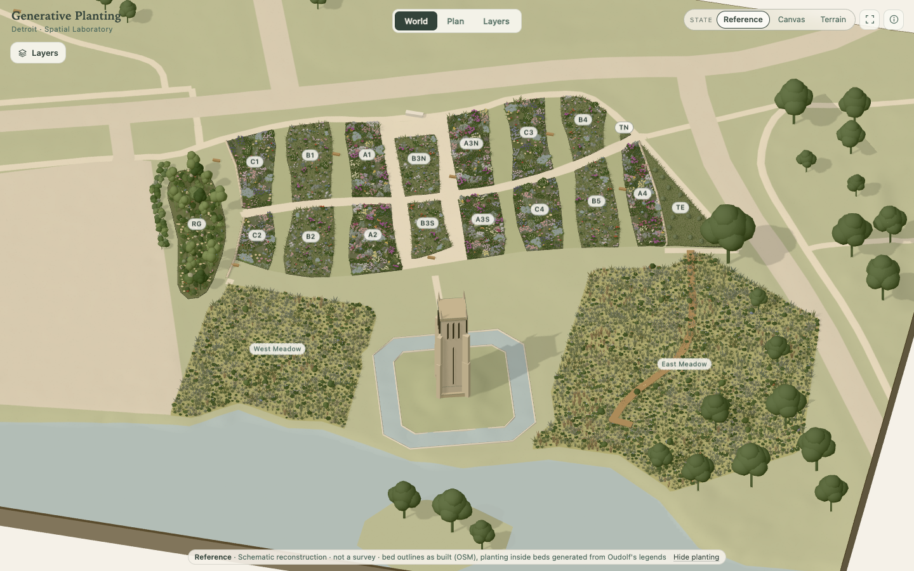
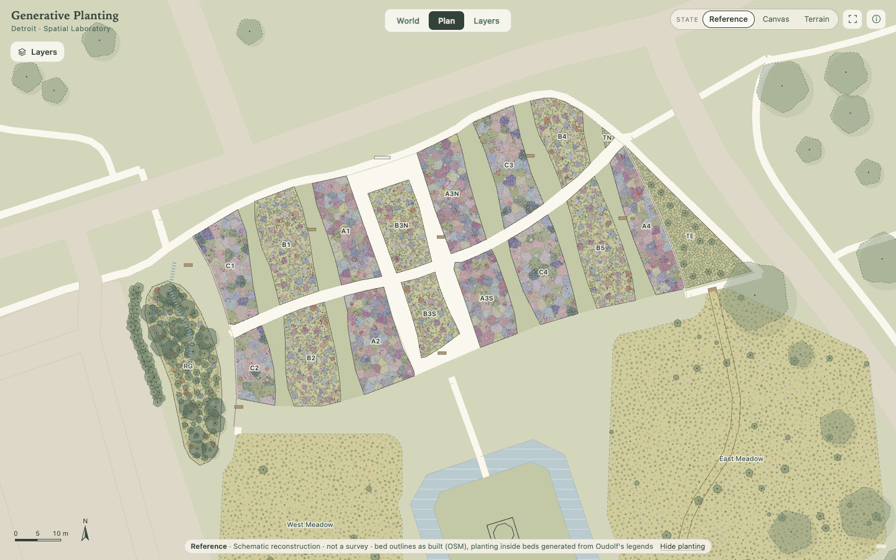
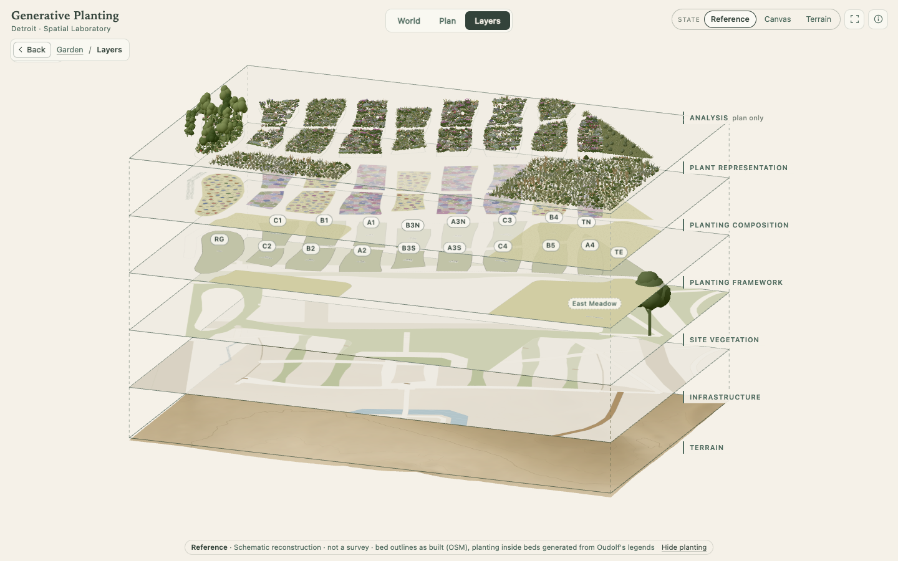

# Generative Planting — Detroit · Spatial Laboratory (Phase 01.1)

**Live:** https://kaiyankay.github.io/Generative-Planting/



A computable spatial model of **Oudolf Garden Detroit** on Belle Isle — the 15 main beds (Block A, Matrix B, Grouping C), the two Triangles, the Rain Garden, the Bird Border and the Native Meadows, with walks, walls, terrain, the Carillon and existing trees. It is the **spatial input** for later AI-assisted planting research; no AI runs here.

**One site, separate designs.** The site (terrain, paths, structures, existing trees) and the bed framework are shared. On top sit a frozen **Reference** (the schematic reconstruction of the original planting) and an editable **Canvas** (a working design: a copy of the reference or a blank planting). **Terrain** shows the ground alone. One model drives the 3D **World**, the orthographic **Plan** and the **Layers** overview; an edit to the working design changes the plan symbols, the 3D plants, the instance table, queries and exports together.

## What is real and what is drawn

| | Status |
|---|---|
| Bed outlines, walks, walls, roads, Carillon, lake (OpenStreetMap, checked on USGS aerial) | documented |
| Bed codes A1–A4, B1–B5, C1–C4 and each bed's style (Oudolf's 2019/2020 plans) | documented |
| Species of each style and their legend role (block, matrix, group, emergent, bulbs) | documented |
| Terrain (USGS 3DEP 1 m) | documented |
| Existing tree crowns (digitised from USGS NAIP; species unknown) | reconstructed |
| Patch shapes and plant positions inside beds, meadow outlines, Bird Border alignment | **schematic** — generated from the documented structure with fixed seeds; not a survey and not a tracing of the drawings |
| Sun, soil moisture, pH | unknown (shown as n/a, never 0) |

Details: [docs/SOURCE_REGISTER.md](docs/SOURCE_REGISTER.md).

## Using it

- **World · Plan · Layers** at the top (keys `1` `2` `3`), **Fit** or `F`. **State: Reference · Canvas · Terrain** at the top right — a separate control: it changes what design you look at, not how.
- **Layers** view: the model pulled apart into Terrain, Infrastructure, Site Vegetation, Planting Framework, Planting Composition and Plant Representation. Click a plate (or its label) to focus it, then **Open in Plan** (or `Enter`, or double-click) for that layer alone in plan, with its own legend, sources and properties; add other layers as **reference overlays** with an opacity slider. **Back** / `Esc` returns with the camera you had.
- **Canvas**: the first time, a dialog shows what a blank design would clear (and what stays) before anything happens. *Hide planting* in the status line only hides the reference; it never deletes.
- **Click** a bed, again for a patch, again for a plant; `Backspace` selects the parent, `Esc` clears. The inspector shows evidence status, sources and conditions at the clicked point.
- The layer index (left) uses the same seven groups: eye = visible, lock = not selectable, arrow = open in Plan.
- For code and agents: `window.GP` — exact spatial queries, validated atomic patches, export / import with instance state ([docs/MODEL_CONTRACT.md](docs/MODEL_CONTRACT.md)). `?dev=1` adds a small patch-test box to the inspector in Canvas.





## Build and test

No Node toolchain is needed: the app is static ES modules with a vendored three.js (r186, MIT).

```bash
python3 -I tools/fetch_sources.py      # OSM + USGS NAIP + 3DEP into sources/raw (optional, data is committed)
python3 -I tools/build_rasters.py      # ortho + terrain in the local frame
python3 -I tools/build_model.py        # data/detroit/model.json + instances.bin
python3 -I tools/test_model.py         # model contract tests
python3 -I tools/run_browser_tests.py  # headless Chrome, app served under /Generative-Planting/ (~6 min)
python3 -I tools/screenshots.py         # docs/screenshots/phase-01-1/ (~40 min)
python3 -m http.server 8780            # then open http://localhost:8780/
```

Python needs `shapely`, `numpy`, `Pillow`. The browser tests need Google Chrome.

## Documents

- [docs/PHASE_01_1_HANDOFF.md](docs/PHASE_01_1_HANDOFF.md) — Phase 01.1 handoff (Chinese)
- [docs/PHASE_01_1_QA.md](docs/PHASE_01_1_QA.md) — tests, screenshots, performance, deployment check
- [docs/PHASE_01_1_ACCURACY.md](docs/PHASE_01_1_ACCURACY.md) — per-bed evidence, drawing vs model, synonym vs substitution
- [docs/PHASE_01_1_ART_DIRECTION.md](docs/PHASE_01_1_ART_DIRECTION.md) — visual language and the style test
- [docs/MODEL_CONTRACT.md](docs/MODEL_CONTRACT.md) — schema, coordinates, scenarios, query and patch API
- [docs/SOURCE_REGISTER.md](docs/SOURCE_REGISTER.md) — sources, versions, licences, accuracy per region
- [docs/SLIDES_TO_MODEL.md](docs/SLIDES_TO_MODEL.md) — research framing → model decisions
- Phase 01: [docs/FINAL_HANDOFF.md](docs/FINAL_HANDOFF.md), [docs/QA_REPORT.md](docs/QA_REPORT.md), screenshots in `docs/screenshots/`

## Licences

Code: MIT. Geometry derived from OpenStreetMap in `data/detroit/model.json`: **ODbL 1.0**, © OpenStreetMap contributors. USGS NAIP / 3DEP: US public domain. Oudolf drawings, plant-list PDFs, photographs and the course slides are not in this repository.
