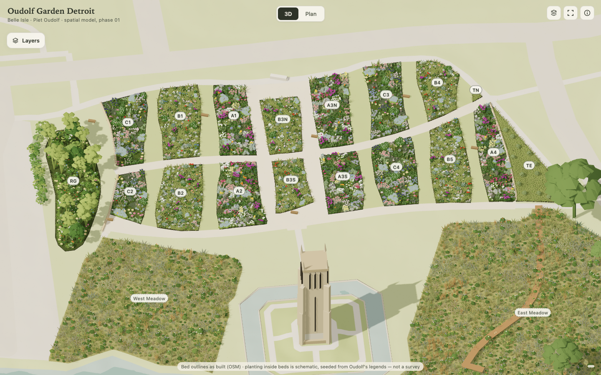
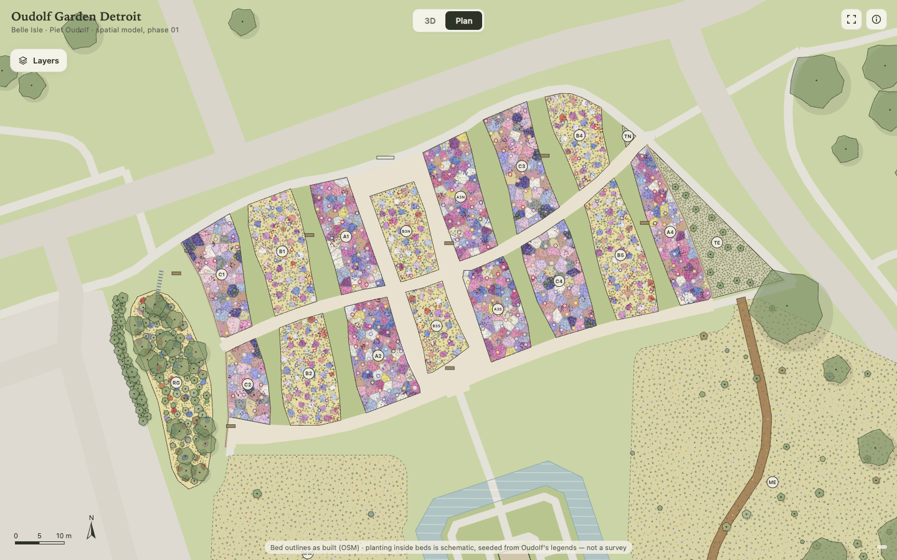
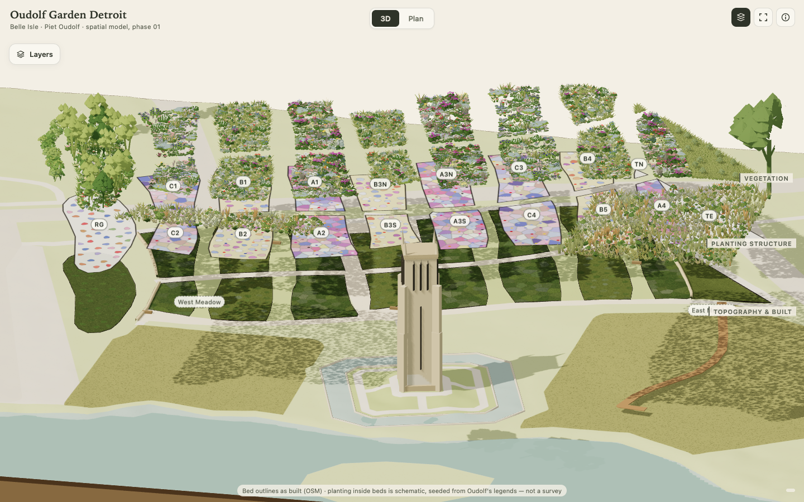

# Generative Planting — Oudolf Garden Detroit, spatial model (Phase 01)

**Live:** https://kaiyankay.github.io/Generative-Planting/



An AI-ready, explorable reconstruction of **Piet Oudolf's garden on Belle Isle, Detroit**: the 15 main beds (Block A, Matrix B and Grouping C), the two Triangles, the Rain Garden, the Bird Border and the Native Meadows, with walks, walls, terrain, the Carillon and existing trees. One canonical model drives a Rhino-like **Plan** and a botanical **3D** diorama; both share layers and selection.

This is Phase 01 of a research project on generative planting design: the **spatial input** a later AI will read, query and propose changes to. No AI runs here.

## What is real and what is drawn

| | Status |
|---|---|
| Bed outlines, walks, walls, roads, Carillon, lake (OpenStreetMap, checked on USGS aerial) | documented |
| Bed codes A1–A4, B1–B5, C1–C4 and each bed's style (Oudolf's 2019/2020 plans) | documented |
| Species of each style and their legend role (block, matrix, group, emergent, bulbs) | documented |
| Terrain (USGS 3DEP 1 m) | documented |
| Existing tree crowns (digitised from USGS NAIP; species unknown) | reconstructed |
| Patch shapes and plant positions inside beds, meadow outlines, Bird Border alignment | **schematic** — generated from the documented structure with fixed seeds; not a survey and not a tracing of the drawings |
| Sun, soil moisture, pH | unknown (shown as n/a, never 0) |

Details: [docs/SOURCE_REGISTER.md](docs/SOURCE_REGISTER.md).

## Using it

- **3D / Plan** switch at the top (keys `1` / `2`). **Fit** button or `F` resets the view.
- **Click** a bed to select it; click again inside to drill down to a patch, then to a single plant. `Backspace` selects the parent, `Esc` clears.
- **Layers** (top left): eye = visibility, lock = not selectable. Groups switch their children.
- The **inspector** shows provenance (status, sources), official counts, the bed's recipe, and conditions at the clicked point.
- 3D: drag to orbit, right-drag to pan, wheel to zoom; close-ups switch to detailed plant forms.
- **Exploded layers** (stack icon, or `E`, 3D only): Topography & built · Planting structure · Vegetation pulled apart, like a Rhino/Grasshopper layer stack.
- For code and agents: `window.GP` (see [docs/MODEL_CONTRACT.md](docs/MODEL_CONTRACT.md)).





## Build and test

No Node toolchain is needed: the app is static ES modules with a vendored three.js (r186, MIT).

```bash
python3 -I tools/fetch_sources.py      # OSM + USGS NAIP + 3DEP into sources/raw (optional, data is committed)
python3 -I tools/build_rasters.py      # ortho + terrain in the local frame
python3 -I tools/build_model.py        # data/detroit/model.json + instances.bin
python3 -I tools/test_model.py         # model contract tests
python3 -I tools/run_browser_tests.py  # headless Chrome, app served under /Generative-Planting/
python3 -m http.server 8780            # then open http://localhost:8780/
```

Python needs `shapely`, `numpy`, `Pillow`. The browser tests need Google Chrome.

## Documents

- [docs/FINAL_HANDOFF.md](docs/FINAL_HANDOFF.md) — morning summary (Chinese)
- [docs/QA_REPORT.md](docs/QA_REPORT.md) — tests, coverage, visual reviews, performance, deployment check
- [docs/MODEL_CONTRACT.md](docs/MODEL_CONTRACT.md) — schema, coordinates, layers, API
- [docs/SOURCE_REGISTER.md](docs/SOURCE_REGISTER.md) — sources, versions, licences, accuracy per region
- [docs/SLIDES_TO_MODEL.md](docs/SLIDES_TO_MODEL.md) — research framing → model decisions
- [docs/OVERNIGHT_STATUS.md](docs/OVERNIGHT_STATUS.md) — checkpoint

## Credits and limits

Map data © OpenStreetMap contributors (ODbL). Aerial imagery and elevation: USGS / USDA, The National Map (public domain). Planting design © Piet Oudolf; plant lists and plans © Oudolf Garden Detroit — cited as facts, not reproduced. three.js © three.js authors (MIT). Code in this repository: MIT.

Limits: the arrangement inside beds is schematic; counts are published per style (March 2023), so per-bed numbers are estimates; no phenology, soil or light data; the triangles' species are not published.
