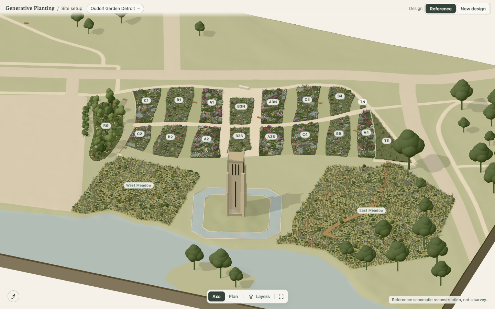
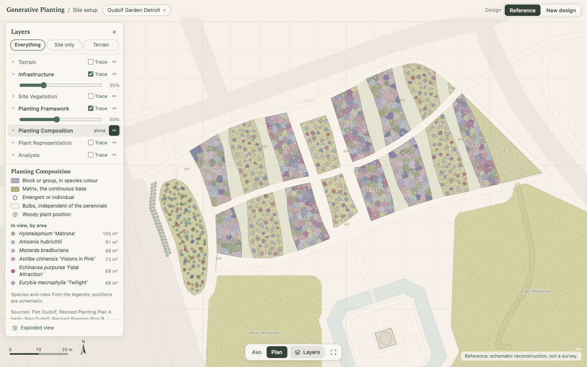

# Generative Planting · Site setup

**Live:** https://kaiyankay.github.io/Generative-Planting/



Generative Planting is an AI-assisted planting design tool. This repository is its **Site setup / Spatial input** module: load a site preset, read its terrain, infrastructure, existing vegetation and bed framework, and start a working planting design from the existing (reference) planting or from empty beds. It is built to be embedded in the full workflow (`?embed=1`, `postMessage` API). No AI runs here.

The first site preset is **Oudolf Garden Detroit** on Belle Isle — the 15 main beds (Block A, Matrix B, Grouping C), the two Triangles, the Rain Garden, the Bird Border and the Native Meadows, with walks, walls, terrain, the Carillon and existing trees. More sites are added in `data/presets.json`, not in the code.

## What is real and what is drawn

| | Status |
|---|---|
| Bed outlines, walks, walls, roads, Carillon, lake (OpenStreetMap, checked on USGS aerial) | documented |
| Bed codes A1–A4, B1–B5, C1–C4 and each bed's style (Oudolf's 2019/2020 plans) | documented |
| Species of each style and their legend role (block, matrix, group, emergent, bulbs) | documented |
| Terrain (USGS 3DEP 1 m) | documented |
| Existing tree crowns (digitised from USGS NAIP; species unknown) | reconstructed |
| Patch shapes and plant positions inside beds, meadow outlines, Bird Border alignment | **schematic** — generated from the documented structure with fixed seeds; not a survey and not a tracing of the drawings |
| Sun, soil moisture, pH | unknown (shown as n/a, never 0) |

Details: [docs/SOURCE_REGISTER.md](docs/SOURCE_REGISTER.md).

## Using it

- The site opens on a fixed **axonometric**. **Axo · Plan** on the canvas toolbar are two ways of looking at the same canvas; the same place and scale carry over. Left-drag pans, wheel zooms, right-drag rotates the axo, **Reset view** (F) returns to the standard angle.
- **Design** (top right): **Reference** is the original planting, reconstructed and read-only. **New design** starts a **working design** from the reference planting or from blank beds; the reference never changes. The ⋯ menu holds undo all, export, start new and delete.
- **Layers** (toolbar, L): seven groups, each with visibility and **show alone in plan**. While one layer is alone, the others become **Trace** overlays with an opacity slider. *Show: Everything · Site only · Terrain* filters the view (it is not a design). **Exploded view** at the bottom of the panel explains how the layers stack.
- Click a bed, a patch, a plant: a small card says what it is, which design, and how certain. **Details** opens the record, sources and ids. Esc steps back one level at a time.
- **Conditions** (bed card, or C): every bed is a computational unit on the 1 m terrain grid. Show elevation, slope, distance to path, to the bed edge or to walls in bands no finer than the data's accuracy, or combine conditions with thresholds into **zones** that stay inside the bed and keep its id. Shift-click adds beds; *All design beds* takes the 20 beds open to design. *Hide planting* only hides; *Empty these beds in a new design* starts a working design in which only those beds are empty — the fields and zones do not change. Sun, soil moisture and pH have no data and are never shown as 0.
- For code and the wider workflow: `window.GP`, or `postMessage` when embedded ([docs/MODEL_CONTRACT.md](docs/MODEL_CONTRACT.md), [docs/COMPUTATIONAL_SPACE.md](docs/COMPUTATIONAL_SPACE.md)).



## Build and test

No Node toolchain is needed: the app is static ES modules with a vendored three.js (r186, MIT).

```bash
python3 -I tools/fetch_sources.py      # OSM + USGS NAIP + 3DEP into sources/raw (optional, data is committed)
python3 -I tools/build_rasters.py      # ortho + terrain in the local frame
python3 -I tools/build_model.py        # data/detroit/model.json + instances.bin
python3 -I tools/test_model.py         # model contract tests
python3 -I tools/run_browser_tests.py  # headless Chrome, app served under /Generative-Planting/ (~6 min)
python3 -I tools/acceptance_run.py     # one real Chrome session, B1 acceptance steps 1–10 -> docs/screenshots/phase-01-3/ + docs/qa/acceptance_run.json
python3 -I tools/test_compute.py       # independent shapely/numpy recomputation of B1, compared with the browser's
python3 -I tools/screenshots.py         # docs/screenshots/phase-01-1/ (~40 min)
python3 -m http.server 8780            # then open http://localhost:8780/
```

Python needs `shapely`, `numpy`, `Pillow`. The browser tests need Google Chrome.

## Documents

- [docs/PHASE_01_3_HANDOFF.md](docs/PHASE_01_3_HANDOFF.md) — Phase 01.3 computational spatial foundation: handoff, acceptance run, old vs new (Chinese)
- [docs/COMPUTATIONAL_SPACE.md](docs/COMPUTATIONAL_SPACE.md) — computational space: five levels, lattice, domains, fields, zones, API
- [docs/PHASE_01_2_UX_AUDIT.md](docs/PHASE_01_2_UX_AUDIT.md) — Phase 01.2 UX/UI audit and component simplification (Chinese)
- [docs/PHASE_01_1_HANDOFF.md](docs/PHASE_01_1_HANDOFF.md) — Phase 01.1 handoff (Chinese)
- [docs/PHASE_01_1_QA.md](docs/PHASE_01_1_QA.md) — tests, screenshots, performance, deployment check
- [docs/PHASE_01_1_ACCURACY.md](docs/PHASE_01_1_ACCURACY.md) — per-bed evidence, drawing vs model, synonym vs substitution
- [docs/PHASE_01_1_ART_DIRECTION.md](docs/PHASE_01_1_ART_DIRECTION.md) — visual language and the style test
- [docs/MODEL_CONTRACT.md](docs/MODEL_CONTRACT.md) — schema, coordinates, scenarios, query and patch API
- [docs/SOURCE_REGISTER.md](docs/SOURCE_REGISTER.md) — sources, versions, licences, accuracy per region
- [docs/SLIDES_TO_MODEL.md](docs/SLIDES_TO_MODEL.md) — research framing → model decisions
- Phase 01: [docs/FINAL_HANDOFF.md](docs/FINAL_HANDOFF.md), [docs/QA_REPORT.md](docs/QA_REPORT.md), screenshots in `docs/screenshots/`

## Licences

Code: MIT. Geometry derived from OpenStreetMap in `data/detroit/model.json`: **ODbL 1.0**, © OpenStreetMap contributors. USGS NAIP / 3DEP: US public domain. Oudolf drawings, plant-list PDFs, photographs and the course slides are not in this repository.
