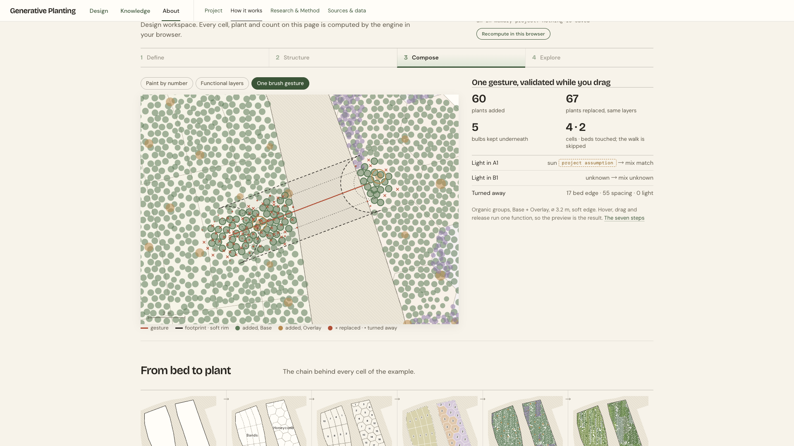
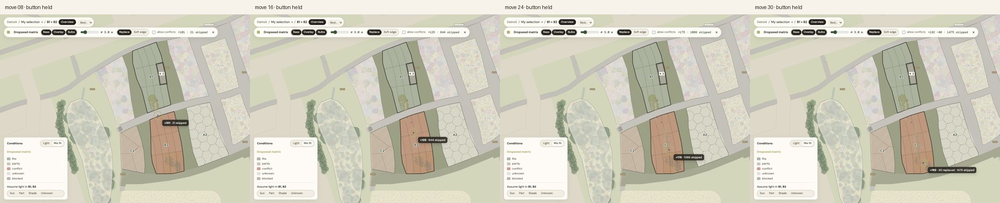
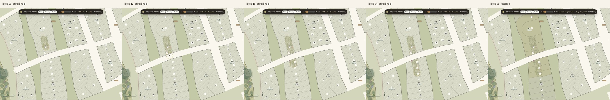
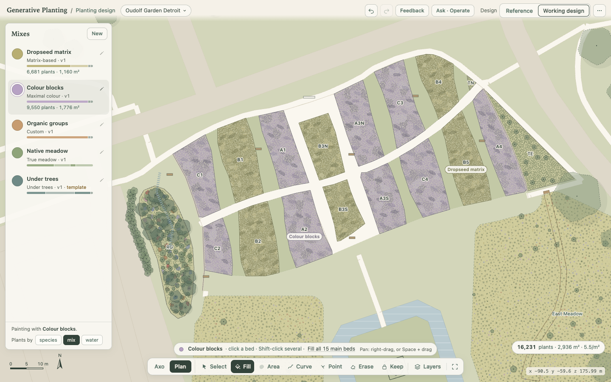
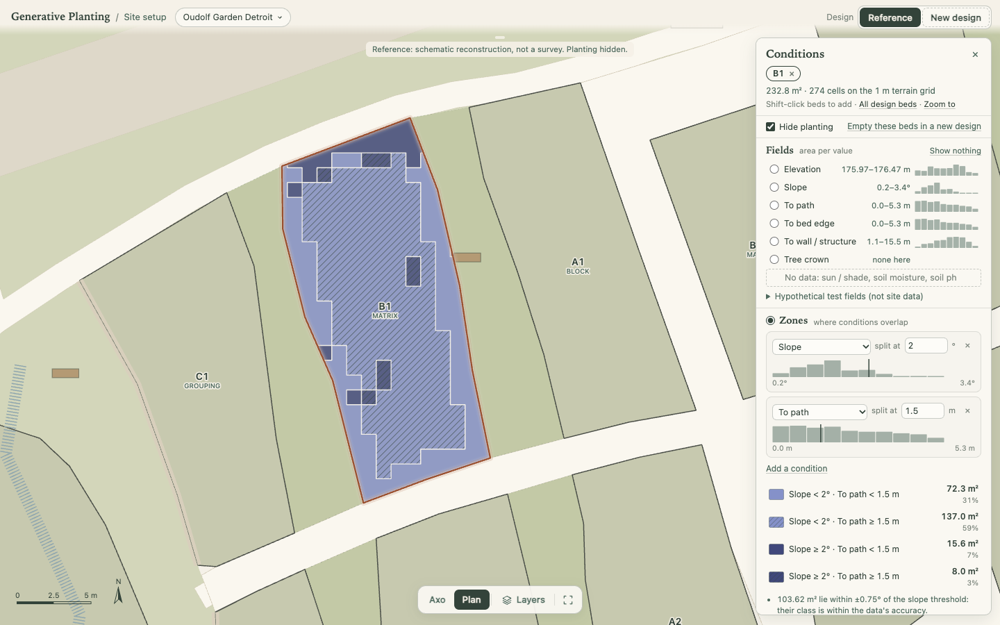

# Generative Planting · About (How it works · Research & Method · Sources & data)

> **Branch `feature/integrated-prototype` (PR #1, not merged; `main` and GitHub Pages unchanged).** About is a workspace beside
> Design and Knowledge (top bar of the app, and *About the research* on the introduction): `about/` Project ·
> `about/how-it-works/` · `about/method/` · `about/data/`. It inherits the Planting Intelligence About (its `platform.css` /
> `about.css`, editorial layout, stage tabs, numbered method steps, expanders) with this project's content.
> Every drawing of a plant is the real engine's output: `about/js/case.js` designs beds **B1 + A1** of the Detroit model with the
> same Project commands as Design (Rules-mode strategy → three spatial logics → numbered cells → five legend mixes painted by
> number → one soft-edge brush gesture → perf/3 by month), in an **in-memory project that is never saved** (`about/js/engine.js`
> also refuses any write to the app's `gp.*` storage keys while it runs). The pages read the stored run
> `about/data/case.json` for an instant start; *Recompute in this browser* (How it works) runs the engine again and compares the
> fingerprints. Course diagrams (ASLA 2024 *Generative Planting at Scale*, P24–26, P32, P34–36, P41, P69–72, P110, P135) are
> redrawn from the example; the slides are not in the repository.
>
> Build and check: `python3 -I -u tools/about_build.py` (two engine runs must give identical fingerprints → writes
> `about/data/case.json`; 24 screenshots at 1920 × 1080 and 1440 × 900 → `docs/screenshots/about/`; console errors and missing
> resources → `docs/qa/about_build.json`). Returning to Design uses `?resume=1`, to Knowledge `?resume=1&ws=knowledge`.
>
> 

# Generative Planting V3.1 · Integrated experience, refined and distilled

> **Branch `feature/integrated-prototype` (PR #1, not merged; `main` and GitHub Pages unchanged).** V3.1 refines V2 (kept as
> tag `v2/integrated-prototype-6fd9001`): the introduction is unchanged; each stage has its own working view (month,
> performance and timeline only in Explore); the design **scope** (confirmed beds: click, Shift-click, Shift-drag, presets)
> is separate from the camera **focus** (a bed, Overview, breadcrumb) and the camera fits the work automatically; the live
> brush evaluates hover and stroke with ONE function (bed edge as the only hard inset, spacing across cells, light =
> your assumption > crown proxy > unknown, conflicts swapped / skipped / explicitly allowed, soft edges, blocked reasons at
> the cursor) and redraws only what it touches (19k-plant design: frame p95 283 → 17 ms on this Mac); **Explore** is its
> own result space (scope only, Plan · 3D · Diagram · Performance, months in 2D and 3D, a community inspector computed from
> the real instances); **Knowledge** reads the project's Detroit plants first (Plants · Seasons · Communities · Relations ·
> Notebook), with Metro Vancouver records only on request and labelled.
>
> Run: `python3 -I tools/flow_server.py --port 8796` → http://127.0.0.1:8796/ · tests: `python3 -I -u tools/v3_unit.py`
> (engine, 71) · `python3 -I -u tools/v3_e2e.py --serve <snapshot>` (real-mouse journey) · `python3 -I -u tools/v3_perf.py
> --serve <snapshot> --label <name> --gpu` (brush trace) · `python3 tools/v3_report.py` · read first: [HANDOFF.md](HANDOFF.md) (中文),
> [docs/integrated/V3_REPORT.md](docs/integrated/V3_REPORT.md), [docs/integrated/ALGORITHMS_V3.md](docs/integrated/ALGORITHMS_V3.md),
> [docs/integrated/DESIGN_CHANGES_V3.md](docs/integrated/DESIGN_CHANGES_V3.md), [docs/qa/V3_E2E.md](docs/qa/V3_E2E.md).
> No language model is called (Rules mode, labelled); Detroit flowering / pollinator / light values in use come mostly from
> the switchable, labelled **illustrative teaching layer**.
>
> 

# Generative Planting V2 · Integrated Design Experience

> **Branch `feature/integrated-prototype` (PR #1, not merged; `main` and GitHub Pages unchanged).** V2 builds on the
> Integrated Prototype (V1 kept as tag `v1/integrated-prototype-e64f437`): Introduction → choose a landscape (axonometric
> cards; only Detroit has a real model) → **Define** one strategy for the whole site (zones = role · Planting System ·
> spatial logic, drawn on the map, one confirm) → **Structure** every zone at once (curved bands along the paths, shared
> axes, guide curves, honeycomb, organic, whole area) → **Compose** with layered Mixes of four Planting Systems and a
> **live Generative Brush** (plants appear while you drag, across beds, paths skipped; Cell Fill and Auto Compose run on
> the same engine) → **Explore** on the same canvas (bottom dock: Plan · Axo · Diagram · Performance, month timeline):
> flowering-resource distribution from the placed plants, issues back to Compose, option comparison. **Knowledge** brings
> back the V4.3 X · Plants → Z → Y network with four relationship lenses. Visual language: Planting Intelligence V4.3.
>
> Run: `python3 -I tools/flow_server.py --port 8796` → http://127.0.0.1:8796/ · tests: `python3 -I -u tools/v2_e2e.py`
> (engine + real-mouse journey) then `python3 tools/v2_report.py` · read first: [HANDOFF.md](HANDOFF.md) (中文),
> [docs/integrated/V2_REPORT.md](docs/integrated/V2_REPORT.md), [docs/integrated/ALGORITHMS_V2.md](docs/integrated/ALGORITHMS_V2.md),
> [docs/integrated/DESIGN_CHANGES_V2.md](docs/integrated/DESIGN_CHANGES_V2.md), [docs/qa/V2_E2E.md](docs/qa/V2_E2E.md).
> No language model is called (Rules mode, labelled). Detroit flowering / pollinator values come from the switchable,
> labelled **illustrative teaching layer**.
>
> 

# Generative Planting · Integrated Prototype (Define → Structure → Compose → Explore)

> **Branch `feature/integrated-prototype`** — one app, one project state, four stages on the real Detroit model:
> **Define** an intent and an editable brief (knowledge sources in use, unknowns stated) → **Structure** beds into
> numbered cells with an adaptive spatial logic (Honeycomb · Bands · Organic patches) → **Compose** reusable Mixes
> (Rules-mode suggestion or by hand, same library) and assign them to cells (paint or Auto compose) so that real plant
> instances are placed → **Explore** pollinator resources, seasonality and adaptability by month from the placed plants,
> follow issues back to the cell or mix, save, compare, export. Knowledge stays a parallel workspace (top bar).
>
> Run: `python3 -I tools/flow_server.py --port 8796` → http://127.0.0.1:8796/ · tests: `python3 -I -u tools/flow_e2e.py`
> then `python3 -I tools/flow_report.py` · read first: [HANDOFF.md](HANDOFF.md) (中文),
> [docs/integrated/IMPLEMENTATION_REPORT.md](docs/integrated/IMPLEMENTATION_REPORT.md),
> [docs/integrated/ALGORITHMS.md](docs/integrated/ALGORITHMS.md), [docs/qa/FLOW_E2E.md](docs/qa/FLOW_E2E.md).
> No language model is connected (Rules mode, labelled). Flowering / pollinator values for Detroit plants come from a
> switchable **illustrative teaching layer**, labelled "not verified" wherever it is used.
> The previous site-setup + brush prototype is kept at `index.html?classic=1`.

# Generative Planting · Site setup → Integrated Design Prototype

> **Branch `integration/design-prototype`: the Integrated Design Prototype.** One spatial workspace where a site preset is
> entered, a Planting Mix is picked or created, beds / areas / curves / points are painted, and real planned plants are
> generated on the Detroit terrain (2D and 3D from the same data), checked against paths, structures, trees and plant
> knowledge (the public copy of the Knowledge module; the Robertson rows and Metro Vancouver quotes stay in a local
> research copy), then modified and iterated. Start: `python3 -I tools/serve.py --port 8790` → http://127.0.0.1:8790/ (first
> visit: *Empty beds* or *From the reference*; `?demo=1` opens a ready-made design). Read
> [docs/INTEGRATED_HANDOFF.md](docs/INTEGRATED_HANDOFF.md) (Chinese handoff), [docs/DESIGN_CONTRACT.md](docs/DESIGN_CONTRACT.md)
> (data, engine, operations API), [docs/INTEGRATED_RESEARCH.md](docs/INTEGRATED_RESEARCH.md) (research basis) and
> [docs/qa/design_e2e.json](docs/qa/design_e2e.json) (experiments A–F). Tests: `python3 -I tools/design_e2e.py`.
>
> 

**Live:** https://kaiyankay.github.io/Generative-Planting/


Generative Planting is an AI-assisted planting design tool. This repository is its **Site setup / Spatial input** module: load a site preset, read its terrain, infrastructure, existing vegetation and bed framework, and start a working planting design from the existing (reference) planting or from empty beds. It is built to be embedded in the full workflow (`?embed=1`, `postMessage` API). No AI runs here.

The first site preset is **Oudolf Garden Detroit** on Belle Isle — the 15 main beds (Block A, Matrix B, Grouping C), the two Triangles, the Rain Garden, the Bird Border and the Native Meadows, with walks, walls, terrain, the Carillon and existing trees. More sites are added in `data/presets.json`, not in the code.

## What is real and what is drawn

| | Status |
|---|---|
| Bed outlines, walks, walls, roads, Carillon, lake (OpenStreetMap, checked on USGS aerial) | documented |
| Bed codes A1–A4, B1–B5, C1–C4 and each bed's style (Oudolf's 2019/2020 plans) | documented |
| Species of each style and their legend role (block, matrix, group, emergent, bulbs) | documented |
| Terrain (USGS 3DEP 1 m) | documented |
| Existing tree crowns (digitised from USGS NAIP; species unknown) | reconstructed |
| Patch shapes and plant positions inside beds, meadow outlines, Bird Border alignment | **schematic** — generated from the documented structure with fixed seeds; not a survey and not a tracing of the drawings |
| Sun, soil moisture, pH | unknown (shown as n/a, never 0) |

Details: [docs/SOURCE_REGISTER.md](docs/SOURCE_REGISTER.md).

## Using it

- The site opens on a fixed **axonometric**. **Axo · Plan** on the canvas toolbar are two ways of looking at the same canvas; the same place and scale carry over. Left-drag pans, wheel zooms, right-drag rotates the axo, **Reset view** (F) returns to the standard angle.
- **Design** (top right): **Reference** is the original planting, reconstructed and read-only. **New design** starts a **working design** from the reference planting or from blank beds; the reference never changes. The ⋯ menu holds undo all, export, start new and delete.
- **Layers** (toolbar, L): seven groups, each with visibility and **show alone in plan**. While one layer is alone, the others become **Trace** overlays with an opacity slider. *Show: Everything · Site only · Terrain* filters the view (it is not a design). **Exploded view** at the bottom of the panel explains how the layers stack.
- Click a bed, a patch, a plant: a small card says what it is, which design, and how certain. **Details** opens the record, sources and ids. Esc steps back one level at a time.
- **Conditions** (bed card, or C): every bed is a computational unit on the 1 m terrain grid. Show elevation, slope, distance to path, to the bed edge or to walls in bands no finer than the data's accuracy, or combine conditions with thresholds into **zones** that stay inside the bed and keep its id. Shift-click adds beds; *All design beds* takes the 20 beds open to design. *Hide planting* only hides; *Empty these beds in a new design* starts a working design in which only those beds are empty — the fields and zones do not change. Sun, soil moisture and pH have no data and are never shown as 0.
- For code and the wider workflow: `window.GP`, or `postMessage` when embedded ([docs/MODEL_CONTRACT.md](docs/MODEL_CONTRACT.md), [docs/COMPUTATIONAL_SPACE.md](docs/COMPUTATIONAL_SPACE.md)).




## Build and test

No Node toolchain is needed: the app is static ES modules with a vendored three.js (r186, MIT).

```bash
python3 -I tools/fetch_sources.py      # OSM + USGS NAIP + 3DEP into sources/raw (optional, data is committed)
python3 -I tools/build_rasters.py      # ortho + terrain in the local frame
python3 -I tools/build_model.py        # data/detroit/model.json + instances.bin
python3 -I tools/test_model.py         # model contract tests
python3 -I tools/run_browser_tests.py  # headless Chrome, app served under /Generative-Planting/ (~6 min)
python3 -I tools/acceptance_run.py     # one real Chrome session, B1 acceptance steps 1–10 -> docs/screenshots/phase-01-3/ + docs/qa/acceptance_run.json
python3 -I tools/test_compute.py       # independent shapely/numpy recomputation of B1, compared with the browser's
python3 -I tools/screenshots.py         # docs/screenshots/phase-01-1/ (~40 min)
python3 -m http.server 8780            # then open http://localhost:8780/
```

Python needs `shapely`, `numpy`, `Pillow`. The browser tests need Google Chrome.

## Documents

- [docs/PHASE_01_3_HANDOFF.md](docs/PHASE_01_3_HANDOFF.md) — Phase 01.3 computational spatial foundation: handoff, acceptance run, old vs new (Chinese)
- [docs/COMPUTATIONAL_SPACE.md](docs/COMPUTATIONAL_SPACE.md) — computational space: five levels, lattice, domains, fields, zones, API
- [docs/PHASE_01_2_UX_AUDIT.md](docs/PHASE_01_2_UX_AUDIT.md) — Phase 01.2 UX/UI audit and component simplification (Chinese)
- [docs/PHASE_01_1_HANDOFF.md](docs/PHASE_01_1_HANDOFF.md) — Phase 01.1 handoff (Chinese)
- [docs/PHASE_01_1_QA.md](docs/PHASE_01_1_QA.md) — tests, screenshots, performance, deployment check
- [docs/PHASE_01_1_ACCURACY.md](docs/PHASE_01_1_ACCURACY.md) — per-bed evidence, drawing vs model, synonym vs substitution
- [docs/PHASE_01_1_ART_DIRECTION.md](docs/PHASE_01_1_ART_DIRECTION.md) — visual language and the style test
- [docs/MODEL_CONTRACT.md](docs/MODEL_CONTRACT.md) — schema, coordinates, scenarios, query and patch API
- [docs/SOURCE_REGISTER.md](docs/SOURCE_REGISTER.md) — sources, versions, licences, accuracy per region
- [docs/SLIDES_TO_MODEL.md](docs/SLIDES_TO_MODEL.md) — research framing → model decisions
- Phase 01: [docs/FINAL_HANDOFF.md](docs/FINAL_HANDOFF.md), [docs/QA_REPORT.md](docs/QA_REPORT.md), screenshots in `docs/screenshots/`

## Licences

Code: MIT. Geometry derived from OpenStreetMap in `data/detroit/model.json`: **ODbL 1.0**, © OpenStreetMap contributors. USGS NAIP / 3DEP: US public domain. Oudolf drawings, plant-list PDFs, photographs and the course slides are not in this repository.
