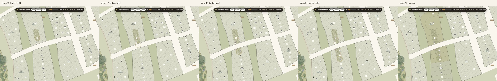

# Generative Planting V2 — test report

Journey run 2026-11-27 05:09:00 → 2026-11-27 05:28:04 · headless Chrome (SwiftShader) over CDP; real mouse / keyboard input

**Engine (flow-tests.html): 60 passed, 0 failed** (12982 ms) · **Journey: 36 passed, 0 failed** · console errors during the journey: 0

## Journey (real mouse / keyboard input, one continuous session)

| # | case | step | action | expected | result | evidence |
|---|---|---|---|---|---|---|
| 1 | A | intro | Open the app in an empty browser profile | A typographic introduction with a plant field drawn from the model's real instances; one Start | **pass** | [shot](../screenshots/v2/01-intro.jpg) `{"title": "GenerativePlanting", "start": true}` |
| 2 | A | choose-landscape | Click Start | Three landscape cards in one axonometric language; only Detroit (real model) can be entered; the other two are 'Planned' | **pass** | [shot](../screenshots/v2/02-choose-landscape.jpg) `{"cards": 3, "disabled": 2}` |
| 3 | A | enter-detroit | Click the Detroit card | Short transition into the Design workspace at Define; no resume prompt (empty profile) | **pass** | [shot](../screenshots/v2/03-enter-detroit.jpg) `{"stage": "define", "intro": false}` |
| 4 | B | strategy-proposed | Click the starter intent “Keep the meadows, … matrix along the main garden paths, early flowers beneath trees, pollinators all season” | A whole-site strategy drawn on the map: ≥ 3 zones (role · system · logic) over ≥ 15 Main Garden beds, meadows kept, Rules mode stated, trees rule reported honestly | **pass** | [shot](../screenshots/v2/04-strategy-proposed.jpg) `{"zones": [["Path matrix", "Matrix Based", "bands", 8], ["Matrix beds", "Matrix Based", "honeycomb", 5], ["Organic groups", "Maximal Color", "organic", 4]], "beds": 17, "kept": ["bed.MW", "bed.ME"], "rules": ["“keep the meadows”", "matrix / coherent", "path / along the paths", "trees / shade / beneath", "early / spring", "beneath trees"], "unused": [], "method": "Rules mode — explicit rules over your words and the si` |
| 5 | B | strategy-confirmed | Click “Confirm strategy” | One undoable confirmation; Continue enabled; no bed-by-bed confirmation | **pass** | [shot](../screenshots/v2/05-strategy-confirmed.jpg) `{"confirmed": true, "undoSteps": 1, "next": true}` |
| 6 | C | structure-preview-all | Click Continue to Structure | Every bed of the strategy previewed at once (curved bands along the paths, honeycomb, organic), no bed fails | **pass** | [shot](../screenshots/v2/06-structure-preview-all.jpg) `{"beds": 17, "cells": 209, "failed": [], "curved": 8, "logics": ["bands", "honeycomb", "organic"], "ms": 2460}` |
| 7 | C | structure-size | Drag the Matrix-beds cell-width slider (real click on the track) | The zone's real candidates change (cell count), only that zone is recomputed | **pass** | [shot](../screenshots/v2/07-structure-size.jpg) `{"zone": "z.matrix", "cellsBefore": 105, "cellsAfter": 22}` |
| 8 | C | structure-guide-curve | “Draw a guide curve” for the path zone, click 4 points across the beds, “Use this curve” | Bands of the zone follow the drawn curve (distance bands from it), clipped by each bed | **pass** | [shot](../screenshots/v2/08-structure-guide-curve.jpg) `{"beds": 8, "curve": 8, "cells": 59, "note": "Curved bands: distance bands from your guide curve; segments cut perpendicular to the guide."}` |
| 9 | C | structure-confirm-all | Click “Confirm N beds” | All beds structured in ONE undo step | **pass** | [shot](../screenshots/v2/09-structure-confirm-all.jpg) `{"beds": 17, "cells": 117, "undoSteps": 1}` |
| 10 | C | structure-refine-bed | Click bed A1 on the canvas, choose Organic, confirm | Only A1 changes (local refinement); every other bed keeps its cell ids | **pass** | [shot](../screenshots/v2/10-structure-refine-bed.jpg) `{"A1": "organic", "othersUnchanged": true}` |
| 11 | D | mix-palette | Continue to Compose | A visual palette: each mix card shows a plan patch from the fill engine, a section, a phenology ribbon, its system; recipes from the Detroit legends (base + overlay + drift) | **pass** | [shot](../screenshots/v2/11-mix-palette.jpg) `{"cards": 3, "svgs": 342, "systems": ["matrix-based", "maximal-color", "maximal-color"], "layers": ["area+count+drift", "area+count+drift", "area+count+drift"]}` |
| 12 | D | mix-compare | Click “compare” on two mix cards | Same-scale plan patches, sections and ribbons side by side | **pass** | [shot](../screenshots/v2/12-mix-compare.jpg) `{"compare": true}` |
| 13 | E | brush-hover | Click the Matrix mix card, move the mouse over bed B1 (no button) | Brush on (HUD), ghost candidates under the cursor, nothing written | **pass** | [shot](../screenshots/v2/13-brush-hover.jpg) `{"brush": true, "hud": true, "ghost": 43, "unchanged": true}` |
| 14 | E | brush-live-stroke | Press on B1, drag across the walk to B2 (25 real mouse moves), release | Plants appear and increase WHILE the button is held (frames + staged counts, nothing committed); on release the same plants are committed in one undo step; no plant on the walk or outside a cell | **pass** | [shot](../screenshots/v2/14-brush-live-stroke.jpg) `{"stagedDuringDrag": [49, 95, 141, 145, 189, 229], "committedDuringDrag": [0], "committedAfter": 267, "undoSteps": 1, "beds": 2, "cells": 7, "plantsOutsideCells": 0, "plantsOnWalk": 0, "meanMoveMs": 10.6, "maxMoveMs": 13.6, "frames": [{"k": 6, "staged": 108, "committed": 0, "frame": "docs/screenshots/v2/E-live-06-pressed.jpg"}, {"k": 12, "staged": 143, "committed": 0, "frame": "docs/screenshots/v2/E-live-12-pressed.j` |
| 15 | E | brush-esc-cancel | Drag over B3N → B3S, press Esc before releasing | Staged plants discarded; design unchanged | **pass** | [shot](../screenshots/v2/15-brush-esc-cancel.jpg) `{"stagedBeforeEsc": 333, "unchanged": true}` |
| 16 | E | brush-undo-redo | Click Undo, then Redo (dock) | The whole stroke disappears and comes back identically | **pass** | [shot](../screenshots/v2/16-brush-undo-redo.jpg) `{"undone": true, "redoneSame": true}` |
| 17 | E | brush-repeat-no-stacking | Drag the same stroke again | Same world-anchored candidates: nothing added, nothing stacked | **pass** | [shot](../screenshots/v2/17-brush-repeat-no-stacking.jpg) `{"added": 0, "same": true}` |
| 18 | E | brush-zoom-metric | Stroke B4 → B5 at two zoom levels (undo between) | The brush is in metres: at both zooms plants lie within the same radius of the stroke | **pass** | [shot](../screenshots/v2/18-brush-zoom-metric.jpg) `{"runs": [{"r": 1.5, "maxDist": 1.5, "added": 585, "scale": 11.3}, {"r": 1.5, "maxDist": 0, "added": 585, "scale": 25}]}` |
| 19 | E | brush-fast-drag | A fast drag: only 3 mouse moves over ~25 m | The stroke is densified (step ≤ radius / 2): no gap along the path inside the beds | **pass** | [shot](../screenshots/v2/19-brush-fast-drag.jpg) `{"tot": 34, "miss": 0, "samples": 34, "moves": 3}` |
| 20 | F | brush-overlay-keeps-matrix | Choose Colour blocks, switch the HUD to Overlay only, drag over the painted matrix | Emergents of the new mix appear over the existing matrix; the matrix (base) is kept exactly | **pass** | [shot](../screenshots/v2/20-brush-overlay-keeps-matrix.jpg) `{"slots": ["overlay"], "baseUnchanged": true, "overlayBefore": 10, "overlayAfter": 19}` |
| 21 | F | cell-fill | Esc (brush off), click a C3 cell, “Fill with Dropseed matrix” in the inspector | The whole cell is filled by the same engine (whole-cell fragment, target vs placed shown) | **pass** | [shot](../screenshots/v2/21-cell-fill.jpg) `{"cell": "c.C3.1", "inst": {"n": 153, "target": 235.6, "frag": ["whole"]}}` |
| 22 | F | freeze | “Freeze” the filled cell, then brush across it | The frozen cell keeps every plant | **pass** | [shot](../screenshots/v2/22-freeze.jpg) `{"frozen": true, "unchanged": true}` |
| 23 | F | auto-compose | Click “Auto compose”, check the dashed proposal, Accept | Unplanted cells get mixes by the documented greedy rule; previewed first; one undo step | **pass** | [shot](../screenshots/v2/23-auto-compose.jpg) `{"proposals": 114, "changed": true, "planted": 130, "cells": 130}` |
| 24 | F | shared-mix-edit | Open the Matrix recipe, set its emergent layer to 1.4 / m², read the impact, “Update all” | Impact previewed (cells, plants before → after, frozen excluded); only fragments of this mix re-filled | **pass** | [shot](../screenshots/v2/24-shared-mix-edit.jpg) `{"impact": {"uses": 117, "before": 15604, "after": 17593, "frozen": 1}, "version": 2}` |
| 25 | F | axo-same-instances | Click Axo in the dock | The 3D view shows the same plant instances (model rows = project plants) | **pass** | [shot](../screenshots/v2/25-axo-same-instances.jpg) `{"view": "3d", "modelRows": 19356, "projectPlants": 19356}` |
| 26 | H | explore-performance | Plan, then Continue to Explore | Performance view: 1 m pixels of flowering plants / m² for the month, unknown hatched, continuity links, short legend; timeline in the dock | **pass** | [shot](../screenshots/v2/26-explore-performance.jpg) `{"stage": "explore", "mode": "performance"}` |
| 27 | G | regions-distribution | Fill bed A2 with Colour blocks and A4 with Organic groups (select cells, Fill), shift-click both beds in Explore, June | Similar area and plant totals; presence can be similar, but flowering counts / fraction / per m² differ; unknown apart | **pass** | [shot](../screenshots/v2/27-regions-distribution.jpg) `{"bed.A2": {"area": 227, "plants": 1632, "flowering": 151, "fraction": 0.093, "perM2": 0.67, "unknown": 1249, "presence": "5/6"}, "bed.A4": {"area": 214, "plants": 1383, "flowering": 304, "fraction": 0.22, "perM2": 1.42, "unknown": 464, "presence": "5/6"}, "table": true}` |
| 28 | G | illustrative-off | Define → untick the Illustrative layer, read June, tick it again | Without the teaching layer the unknown count rises and known flowering falls — shown as unknown, never as 0 | **pass** | [shot](../screenshots/v2/28-illustrative-off.jpg) `{"unknownOn": 7522, "unknownOff": 19003, "floweringOn": 1339, "floweringOff": 0}` |
| 29 | H | views-and-months | Dock: Plan → Axo → Plan → Diagram (structure · mix · arrangement) → Performance; months Apr / Jul / Sep; Play, Pause | Real visual differences, same coordinates; camera target kept; views and timeline never change the design | **pass** | [shot](../screenshots/v2/29-views-and-months.jpg) `{"modes": {"plan": "plan", "axo": "axo", "diagram": "diagram", "performance": "performance"}, "played": true, "designUnchanged": true, "cameraKept": true}` |
| 30 | H | issue-back-to-compose | In “To look at”, click “Repaint these cells”, paint, return to Explore | Compose opens with the issue's cells selected; the change is recomputed in Explore | **pass** | [shot](../screenshots/v2/30-issue-back-to-compose.jpg) `{"issue": "split.5", "stage": "compose", "selected": 60, "changed": true}` |
| 31 | I | knowledge-lenses | Knowledge tab → Ecological association lens, click a plant node, click a line; Matrix, Table; Spatial function lens | X · Plants → Z → Y network from real relations; focus dims the rest; a line shows its evidence; Matrix / Table read the same edges; V4.3 spatial-function relations are back | **pass** | [shot](../screenshots/v2/31-knowledge-lenses.jpg) `{"ecologyEdges": 36, "dimmed": 11, "evidence": true, "matrixCells": 21, "tableRows": 11, "spatialEdges": 24}` |
| 32 | I | knowledge-record | Add a project record (flowering 6–7) for a placed plant with unknown flowering → preview the effect → Apply → Back to the design | The effect (metrics before → after) is shown before applying; after Apply the unknown count falls; the design (stage, selection) is where it was | **pass** | [shot](../screenshots/v2/32-knowledge-record.jpg) `{"plant": "sp.veronicastrum-cupid", "preview": ["Mar: plants in flower 0 → 0, unknown 7577 → 7568", "Apr: plants in flower 0 → 0, unknown 7577 → 7568", "May: plants in flower 2694 → 2694, unknown 7577 → 7568", "Jun: plants in flower 1342 → 1351, unknown 7577 → 7568", "Jul: plants in flower 503 → 512, unknown 7577 → 7568", "Aug: plants in flower 503 → 503, unknown 7577 → 7568", "Sep: plants in flower 478 → 478, unknow` |
| 33 | J | save-compare | “Save this option”, change the design, “compare” | Both options compared with the same definitions, month and scope (recomputed now) | **pass** | [shot](../screenshots/v2/33-save-compare.jpg) `{"snapshots": 1, "compare": true}` |
| 34 | J | export | Export JSON (read) | Instances with x / y / z, slot, fragment and mix version; layered recipes; frozen cells; assumptions | **pass** |  `{"schema": "gp.export/2", "plants": 19008, "z": true, "slot": "base", "frags": 130, "mixes": 3, "layers": 3, "assumptions": 3, "frozen": 1}` |
| 35 | J | reload-resume | Reload the page (resume) | Plants (ids, x, y), fragments, locks, strategy and stage restored | **pass** | [shot](../screenshots/v2/35-reload-resume.jpg) `{"same": true, "fragments": [144, 144], "locks": [1, 1], "stage": "explore"}` |
| 36 | K | narrow-820 | Resize to 820 × 1000 | Canvas above, panel below, dock in two rows; no horizontal overflow | **pass** | [shot](../screenshots/v2/36-narrow-820.jpg) `{"dock": 112, "panelTop": 520, "overflowX": false}` |

## Case E — live brush, frames captured while the mouse button is held

Staged instances during the drag (every 4th of 24 mouse moves): 49, 95, 141, 145, 189, 229; committed plants during the drag: [0] (nothing written before release); after release: +267 in one undo step; beds 2, cells 7; plants on the walk 0, outside a cell 0; mean / max processing per pointer move 10.6 / 13.6 ms (headless Chrome, SwiftShader, this Mac).

Pointer log (each real mouse move with the staged state read right after it): `docs/qa/v2_e2e.json → pointerLog`.

## Engine tests

| id | gate | test | result |
|---|---|---|---|
| S1-honeycomb | G2 | Honeycomb in B1: valid cells (coverage, no overlap, inside, positive) | **pass** |
| S2-honeycomb | G2 | Honeycomb: same input gives identical cells and ids | **pass** |
| S1-bands | G2 | Bands in B1: valid cells (coverage, no overlap, inside, positive) | **pass** |
| S2-bands | G2 | Bands: same input gives identical cells and ids | **pass** |
| S1-organic | G2 | Organic patches in B1: valid cells (coverage, no overlap, inside, positive) | **pass** |
| S2-organic | G2 | Organic patches: same input gives identical cells and ids | **pass** |
| S1-whole | G2 | Whole area in B1: valid cells (coverage, no overlap, inside, positive) | **pass** |
| S2-whole | G2 | Whole area: same input gives identical cells and ids | **pass** |
| S3 | G2 | Cells exclude a path inside a bed (holes): no cell contains a blocker point | **pass** |
| S4 | G2 | FIXTURE: hole is excluded and total area is conserved (bands, honeycomb, organic) | **pass** |
| S5 | G2 | FIXTURE (30 × 7.5 m, path on the short west edge): straight bands (V2: guide "straight"; curved is the default) — continuity ON → parallel to the path (90°), OFF → along the long axis (0°) | **pass** |
| S6 | G2 | FIXTURE: context changes geometry — a 0.6 m slope across the bed turns bands to the contours; flat ground does not | **pass** |
| S7 | G2 | FIXTURE: a tree crown changes the organic layout ranking (fewer cells mixing crown and open ground) | **pass** |
| S8 | G2 | Adjacency: neighbours share ≥ 0.3 m of boundary and are symmetric | **pass** |
| S9 | G2 | Unknown site fields (sun, moisture, pH) stay unknown in cell conditions | **pass** |
| A1 | G2 | Largest remainder: counts sum exactly to the target | **pass** |
| A2 | G2 | Arrangement in a real cell: target = round(area × density), all plants inside the cell, off trunks, deterministic | **pass** |
| P1 | G4 | FIXTURE known example: A {Apr,May} bees, B {Jun,Jul} butterflies → April bees only, June butterflies only, August no known flowering (traits complete) | **pass** |
| P2 | G4 | FIXTURE: replacing B by A changes month and group coverage (June gone, April both cells) | **pass** |
| P3 | G4 | FIXTURE: unknown flowering → uncertain, never "no resource" | **pass** |
| P4 | G4 | FIXTURE: adjacent resource cells form 1 component; separated cells 2 isolated | **pass** |
| P5 | G4 | Empty design and no data: no error, no fabricated values | **pass** |
| P6 | G4 | FIXTURE adaptability (V2: per placed plant): a sun plant placed under a crown is a conflict; unknown light stays uncertain | **pass** |
| K1 | G3 | First use works with an empty personal layer (Rules mode suggests recipes from foundation + site + illustrative) | **pass** |
| K2 | G3 | Changing a known flowering month changes the suggestion: a TEST project record "Salvia Mainacht flowers Oct–Nov, bees, moths" (a month no known plant covers) puts it into the recipe | **pass** |
| K3 | G3 | Scope isolation: the project record is not visible to another project; illustrative off → value unknown | **pass** |
| K4 | G3 | Personal note saved without external verification, visible in the shared knowledge store, used by the design | **pass** |
| K5 | G3 | Conflicting sources stay visible and a scoped choice selects one (no silent overwrite) | **pass** |
| K6 | G3 | Rules-mode intent reading is explicit and does not invent (unused words reported) | **pass** |
| K7 | G3 | Rules-mode edit: "keep the grass matrix, increase spring bloom" adds a spring plant and leaves matrix shares unchanged | **pass** |
| K8 | G3 | Unrecognised edit request is refused in Rules mode, not faked | **pass** |
| L1 | G3 | Model answers are validated: invented evidence id, unknown plant, coordinates and bad sums are refused; a valid answer passes | **pass** |
| L2 | G3 | No language model on a static page: the adapter reports Rules mode; no key in the client | **pass** |
| M1 | G2 | Mix validation (V2 layers): a layer's proportions must sum to 100 %, density in range; normalise is exact | **pass** |
| D1 | G2 | One paint gesture across several cells is one undo step; undo and redo restore the same plants | **pass** |
| D2 | G2 | Auto compose only fills the scope and never changes assigned cells | **pass** |
| D3 | G2 | Edit shared mix → update all uses rearranges only cells of that mix | **pass** |
| D4 | G2 | Local variant changes only the chosen cells; other cells of the shared mix are unchanged | **pass** |
| D5 | G2 | Changing a bed's logic keeps the other bed and remaps by overlap; cancel = no change | **pass** |
| D6 | G1 | Reference planting is not overwritten; base model unchanged | **pass** |
| D7 | G1 | Export holds brief, site units, cell geometry, recipes, quantities, plant x/y/z, performance and caveats | **pass** |
| D8 | G1 | Storage refused → save reports "not saved" and the design stays in memory | **pass** |
| D9 | G4 | Timeline / view changes never change the design | **pass** |
| D10 | G2 | A plant beyond the catalogue can be added (generic proxy, labelled) and placed | **pass** |
| V1 | V2-B | Strategy (Rules mode): the V2 intent over Main Garden gives ≥ 3 zones with different systems / logics; meadows kept; ≥ 15 beds; one confirm | **pass** |
| V2 | V2-C | Structure: every bed of the strategy previewed and committed in ONE undo step; cells valid (no overlap, inside plantable) | **pass** |
| V3 | V2-C | Curved bands follow the path edge on real beds (curved flag, ≥ 2 cells) and size changes the candidates | **pass** |
| V4 | V2-C | Straight bands of a zone share one world anchor: the band phase across two beds is identical (continues across the path) | **pass** |
| V5 | V2-D | Layered mixes: base (area shares + spacing), overlay (own density), drift (coverage); each layer is its own 100 %; 4 system templates exist | **pass** |
| V6 | V2-D | World-anchored lattice: the same mix gives identical candidates (ids and x/y) in overlapping windows; two mixes differ | **pass** |
| V7 | V2-D | Cell Fill: counts follow each layer (base ≈ area × Σ share × hex density, overlay ≈ area × density); changing the overlay density changes overlay plants only | **pass** |
| V8 | V2-E | Live brush: staged instances grow DURING the drag (before pointer-up), the stroke crosses two beds and the walk, the commit is one undo step, no plant outside a cell | **pass** |
| V9 | V2-E | Repeating the same stroke adds nothing (same lattice ids, no stacking); Esc cancel leaves the state unchanged; undo / redo one stroke | **pass** |
| V10 | V2-F | Brush affects only its footprint: plants of the same cells outside the stroke keep their coordinates; other beds untouched | **pass** |
| V11 | V2-F | Overlay-only stroke: the existing matrix (base) under the stroke is kept, only overlay plants change | **pass** |
| V12 | V2-F | Freeze: a frozen cell is skipped by the brush, by Cell Fill and by a shared mix edit | **pass** |
| V13 | V2-F | Local variant changes only the selected cells; Auto Compose fills only unplanted cells with the same engine (plants carry lattice ids) | **pass** |
| V14 | V2-G | FIXTURE distribution: same area, same plant count, same presence — different flowering counts give different fraction and per m² (unknown counted apart) | **pass** |
| V15 | V2-J | Save → reload (restore) keeps fragments, layers, plant ids / x / y, locks and strategy; export has z per plant and assumptions | **pass** |
| V16 | V2-L | Base model unchanged by the V2 design (baseline placements identical) | **pass** |
