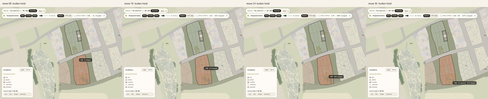
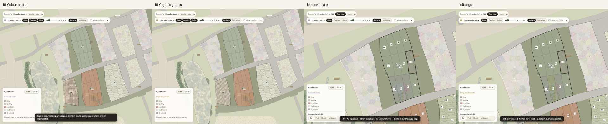
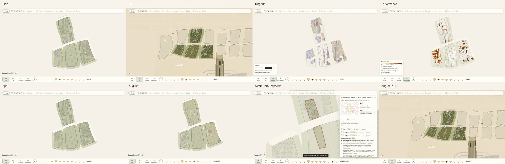
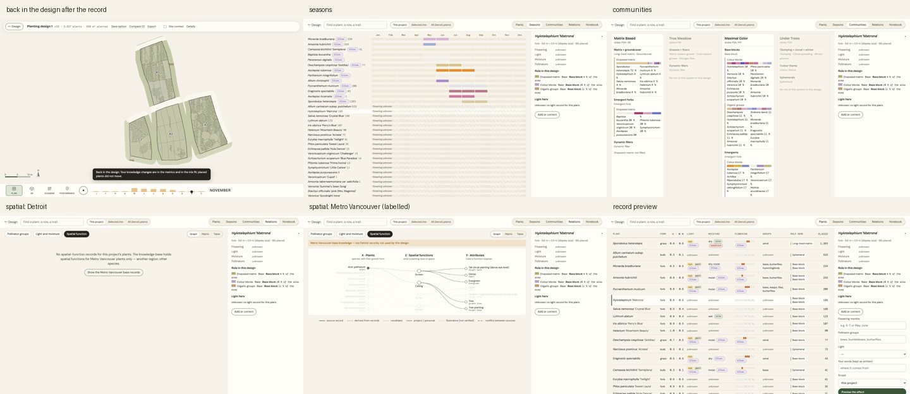

# Generative Planting V3.1 — test report

Journey run 2026-11-27 11:34:00 → 2026-11-27 11:37:02 · headless Chrome over CDP; real mouse / keyboard input

**Engine (flow-tests.html): 71 passed, 0 failed** · **Real-browser journey: 27 passed, 0 failed** · console errors during the journey: 0

## Case H — live brush performance, same machine, same stroke (real mouse events)

Device: MacBookPro14,2 · Intel(R) Core(TM) i5-7267U CPU @ 3.10GHz · macOS 10.16 · Google Chrome 158.0.8127.89 · GPU: ANGLE (Intel, ANGLE Metal Renderer: Intel(R) Iris(TM) Plus Graphics 650, Unspecified Version) · headless · 1440x900 @1x. One stroke: press, 110 moves ≈ 16 ms apart, release; bed B1 → walk → B2 → zig-zag in B2; ⌀ 3 m; Colour-blocks mix over the Auto-Composed design. Tool: `tools/v3_perf.py`; raw frames / inputs / draws: `docs/qa/perf/*.json`.

| build | scenario | frame interval p50 / p95 ms | input → drawn p50 / p95 ms | plan paint p50 ms (kinds) | brush handler p50 / p95 ms | long tasks while held | staged plants at moves 21 / 61 / 101 | worst frame ms |
|---|---|---|---|---|---|---|---|---|
| V2 (6fd9001) | blank (0 plants) | 33.4 / 100.1 | 72.1 / 113 | 11.0 (full 108) | 9.5 / 11.7 | 1 (0 ≥ 100 ms, max 87) | 320, 722, 929 | 216.7 |
| V2 (6fd9001) | large (20,965 plants) | 216.7 / 283.3 | 230.0 / 286.5 | 46.8 (full 108) | 9.1 / 10 | 108 (108 ≥ 100 ms, max 427) | 313, 707, 910 | 916.6 |
| V3.1 | blank (0 plants) | 16.7 / 16.7 | 27.7 / 33.5 | 4.4 (overlay 109, region 108) | 11.2 / 14.3 | 1 (0 ≥ 100 ms, max 79) | 343, 776, 1004 | 66.7 |
| V3.1 | large (21,743 plants) | 16.7 / 16.8 | 35.6 / 39.5 | 8.7 (region 108, overlay 108) | 13.5 / 14.2 | 1 (0 ≥ 100 ms, max 86) | 338, 760, 984 | 533.3 |

Targets of the package: p95 frame ≤ 33 ms, input → visible preview p95 ≤ 100 ms, no long task ≥ 100 ms while drawing. The worst single frame is listed rather than hidden (see the report).

## Journey (one continuous session from an empty profile; real mouse / keyboard)

| # | case | step | action | expected | result | evidence |
|---|---|---|---|---|---|---|
| 1 | A,O | intro | Open the app in an empty browser profile | The V2 introduction (kept): title, plant field from real instances, one Start | **pass** | [shot](../screenshots/v3/01-intro.jpg) `{"title": "GenerativePlanting"}` |
| 2 | A,O | landscapes | Click Start | Three landscape cards; Detroit enterable, two Planned; no saved design to continue | **pass** | [shot](../screenshots/v3/02-landscapes.jpg) `{"cards": 3, "go": "Enter →"}` |
| 3 | A,N | define-entry | Click the Detroit card | Define in Plan over the whole garden: scope on the map, the panel starts with the scope; no timeline, no month, no performance legend, no brush | **pass** | [shot](../screenshots/v3/03-define-entry.jpg) `{"stage": "define", "time": false, "legend": false, "legendText": "", "hud": false, "mode": "plan", "modes": ["plan", "axo"], "phenology": false, "panelVisible": true, "panelScroll": 0, "camera": {"cx": 29.81, "cy": -6.47, "scale": 6.73, "w": 1440, "h": 784, "viewBox": [-77.1, -64.7, 136.7, 51.7]}, "crumb": "Detroit/17 beds3,170 m²"}` |
| 4 | B | define-click-B2 | Click bed B2 on the map | Only B2 is the candidate (dashed outline, others quietened); a strategy is proposed for it; Continue waits for the confirmation | **pass** | [shot](../screenshots/v3/04-define-click-B2.jpg) `{"candidate": ["bed.B2"], "pending": true, "continueEnabled": false, "crumb": "Detroit/1 bed229 m²"}` |
| 5 | B | define-confirm-B2 | Click Confirm | Scope = B2 (one undo step) | **pass** | [shot](../screenshots/v3/05-define-confirm-B2.jpg) `{"scope": ["bed.B2"], "undo": 1}` |
| 6 | B | structure-fit-B2 | Continue to Structure (no wheel, no manual zoom); confirm the cells | The camera fits B2: it fills the free canvas (≥ 55 % of the width or height, fully inside), numbered cells readable; scope IDs = [B2] | **pass** | [shot](../screenshots/v3/06-structure-fit-B2.jpg) `{"coverage": {"bbox": [-34.5, -32.4, -22, -9.5], "screen": [391, 136, 669, 642], "fracW": 0.28, "fracH": 0.74, "inside": true}, "camera": {"cx": -19.64, "cy": -21.1, "scale": 22.1, "w": 1440, "h": 784, "viewBox": [-52.2, -38.8, 12.9, -3.4]}, "cells": 14, "manualZoom": false}` |
| 7 | B | compose-fit-B2 | Continue to Compose | Compose keeps the bed's working scale (fit of the scope = B2); the mix palette is the panel | **pass** | [shot](../screenshots/v3/07-compose-fit-B2.jpg) `{"stage": "compose", "coverage": {"bbox": [-34.5, -32.4, -22, -9.5], "screen": [391, 136, 669, 642], "fracW": 0.28, "fracH": 0.74, "inside": true}, "mixes": ["Dropseed matrix"]}` |
| 8 | B,E | compose-paint-B2 | Click the first mix card, hover over B2, then drag a short stroke | A hover preview with a cursor chip (bed · cell · light · fit · +n); the stroke plants in one undo step | **pass** | [shot](../screenshots/v3/08-compose-paint-B2.jpg) `{"hoverAdds": 75, "chip": "B2·6 · light unknown · fit unknown+75", "hoverWroteNothing": false, "added": 199, "undoSteps": 1}` |
| 9 | A,C | define-return | Click step 1 (Define) | Define shows its own view (Plan, no timeline / month / legend / brush); the B2 plants are kept | **pass** | [shot](../screenshots/v3/09-define-return.jpg) `{"time": false, "legend": false, "legendText": "", "hud": false, "mode": "plan", "modes": ["plan", "axo"], "phenology": false, "panelVisible": true, "panelScroll": 0, "designKept": true, "candidate": ["bed.B2"]}` |
| 10 | C | define-multi | Shift-click B1; Shift-drag a box over A2 and C2; Confirm | B1, B2, A2, C2 (two walks between them) are the new scope; B2 keeps its plants | **pass** | [shot](../screenshots/v3/10-define-multi.jpg) `{"candidate": ["bed.A2", "bed.B1", "bed.B2", "bed.C2"], "scope": ["bed.A2", "bed.B1", "bed.B2", "bed.C2"], "B2kept": true}` |
| 11 | C | structure-multi-fit | Continue to Structure; confirm the new beds (one click) | Only the new beds are previewed (B2 kept), one confirmation; the camera fits the union of all scope beds | **pass** | [shot](../screenshots/v3/11-structure-multi-fit.jpg) `{"previewed": ["bed.B1", "bed.A2", "bed.C2"], "B2unchanged": true, "coverage": {"bbox": [-45.4, -32.4, -5.8, 15.9], "screen": [306, 115, 754, 663], "fracW": 0.46, "fracH": 0.8, "inside": true}, "camera": {"cx": -8.82, "cy": -8.53, "scale": 11.34, "w": 1440, "h": 784, "viewBox": [-72.3, -43.1, 54.7, 26]}}` |
| 12 | C | structure-focus-overview | Click B1 on the map (local focus), then Overview in the breadcrumb | B1 fills the canvas, breadcrumb Detroit / scope / B1; the scope and the other beds stay; Overview returns to the whole scope | **pass** | [shot](../screenshots/v3/12-structure-focus-overview.jpg) `{"focus": ["bed.B1"], "crumb": "Detroit/My selection 4/B1OverviewBed…B1B2A2C2", "fitB1": {"bbox": [-40.9, -10.1, -26.8, 15.9], "screen": [390, 130, 670, 648], "fracW": 0.29, "fracH": 0.76, "inside": true}, "scopeUnchanged": true, "cellsUnchanged": true, "overview": {"bbox": [-45.4, -32.4, -5.8, 15.9], "screen": [306, 115, 754, 663], "fracW": 0.46, "fracH": 0.8, "inside": true}}` |
| 13 | D | conditions-assumptions | Compose → Conditions (dock); focus B1 (breadcrumb) → Sun; B2 → Shade; C2 → Part; A2 untouched; Overview | Explicit project assumptions per bed (labelled), the crown proxy kept, A2 unknown | **pass** | [shot](../screenshots/v3/13-conditions-assumptions.jpg) `{"env": "{\"bed.B1\":\"sun\",\"bed.B2\":\"shade\",\"bed.C2\":\"part\"}", "legend": "Conditionssun · assumedpart shade · assumedshade · assumedunder a crown · proxyunknownFocus a bed to set a light assumpt"}` |
| 14 | D | fit-two-mixes | Click the Colour-blocks mix, then the Organic-groups mix (Conditions on → Mix fit) | Fit per cell from the real members' light records: B1 (sun) fits, B2 (shade) conflicts, C2 (part) differs between the mixes (sun-only vs sun · part members), A2 unknown | **pass** | [shot](../screenshots/v3/14-fit-two-mixes.jpg) `{"colourBlocks": {"bed.B2": {"conflict": 14}, "bed.B1": {"match": 12}, "bed.A2": {"unknown": 25}, "bed.C2": {"partial": 4}, "C2share": {"match": 0.1, "conflict": 0.22, "unknown": 0.68, "why": ["Asclepias tuberosa sun (illustrative)", "Parthenium integrifolium sun (illustrative)", "Allium christophii sun (illustrative)"]}}, "organicGroups": {"bed.B2": {"conflict": 14}, "bed.B1": {"match": 12}, "bed.A2": {"unknown": 25}, "bed.C2": {"partial": 4}, "C2share": {"match": 0.11, "conflict": 0.1, "unknown": 0.79, "why": ["E` |
| 15 | D | layer-off-still-computes | Turn Conditions off, hover the Colour-blocks brush over B2 (shade assumed) | The map layer is off but the rule still applies: sun-recorded members are skipped in the preview (count shown in the chip) | **pass** | [shot](../screenshots/v3/15-layer-off-still-computes.jpg) `{"skipped": 31, "adds": 10, "layerOn": false, "chip": "B2·6 · shade (assumed) · conflict (32 % of the recipe known)+10 · 64 replaced · 31 skipped"}` |
| 16 | E | hover-states | Hover the Colour-blocks brush over B1 (sun), B2 (shade), A2 (unknown), the walk, and a frozen cell (frozen through the cell inspector) | Each place says what would happen next to the cursor: plants to add, skipped for light, unknown, blocked (path), blocked (frozen) — never only 'no plantable cell' | **pass** | [shot](../screenshots/v3/16-hover-states.jpg) `{"legal-B1": {"chip": "B1·9 · sun (assumed) · fits (32 % of the recipe known)+41", "adds": 41, "skipped": 0, "blocked": null}, "conflict-B2": {"chip": "B2·6 · shade (assumed) · conflict (32 % of the recipe known)+12 · 61 replaced · 30 skipped", "adds": 12, "skipped": 30, "blocked": null}, "unknown-A2": {"chip": "A2·7 · light unknown · fit unknown+42", "adds": 42, "skipped": 0, "blocked": null}, "path": {"chip": "B1 centre: path+17", "adds": 17, "skipped": 0, "blocked": "path"}, "frozen": {"chip": "B1·2 centre: froz` |
| 17 | F | live-stroke-two-beds | Dropseed-matrix brush: press in B1, 30 real moves across the walk into B2 (button held), release; Undo; Redo | Plants appear in ≥ 3 frames while held (nothing committed until release), the walk gets none, both beds change in ONE undo step; undo / redo exact | **pass** | [shot](../screenshots/v3/17-live-stroke-two-beds.jpg) `{"stagedAtFrames": [101, 125, 175, 192], "committedWhileHeld": [199], "release": {"added": 192, "removed": 40, "beds": 2, "cells": 10, "bedIds": ["bed.B1", "bed.B2"], "meanMoveMs": 23.6}, "undoSteps": 1, "undoRestoresPlants": true, "redoSame": true, "plantsOutsideCells": 0, "frames": [{"k": 8, "staged": 101, "committed": 199, "frame": "docs/screenshots/v3/16-live-08-held.jpg"}, {"k": 16, "staged": 125, "committed": 199, "frame": "docs/screenshots/v3/16-live-16-held.jpg"}, {"k": 24, "staged": 175, "committed": 199, ` |
| 18 | F | metric-brush-two-zooms | Stroke 3 m across unplanted ground of A2 at the fit zoom, then of C2 after two wheel zooms | Both strokes add plants (fresh ground each time); at both scales the plants lie within the same metric radius of the stroke | **pass** | [shot](../screenshots/v3/18-metric-brush-two-zooms.jpg) `{"runs": [{"r": 1.5, "added": 253, "maxDist": 1.48, "scale": 21.5, "bed": "bed.A2"}, {"r": 1.5, "added": 92, "maxDist": 1.49, "scale": 64.1, "bed": "bed.C2"}]}` |
| 19 | G | overlap-layers | Colour-blocks base over the B1 matrix; then the same stroke with Overlay only; then a Soft-edge matrix stroke back over it | Preview shows replacements before the click; base replaced only inside the footprint, other layers kept; overlay-only adds overlays and leaves the base; soft edge leaves a mixed rim | **pass** | [shot](../screenshots/v3/19-overlap-layers.jpg) `{"preview": {"adds": 38, "replaces": 17}, "baseOverBase": {"added": 93, "removed": 47, "kept": 1}, "outsideFootprintAndOtherLayersKept": true, "overlayOnly": {"added": 1, "removed": 1, "kept": 93}, "baseUnchangedByOverlay": true, "softEdge": {"coreOld": 0, "bandOld": 13, "bandNew": 3}}` |
| 20 | M | cell-fill-auto | Click an empty cell → Fill (inspector); Auto compose → Accept | Cell Fill and Auto Compose use the same engine (one undo step each); the frozen cell is skipped | **pass** | [shot](../screenshots/v3/20-cell-fill-auto.jpg) `{"cellFilled": 57, "autoProposals": 37, "plants": 3521, "unplantedLeft": 1, "frozenCells": 1}` |
| 21 | I,N | explore-result-space | Continue to Explore; switch Plan → 3D → Diagram → Performance → Plan in the dock | Own layout: big canvas with only the design scope (context off), panel closed, top bar (Design · options · export), dock with views + months; every view shows the same instances (fingerprint) and result revision | **pass** | [shot](../screenshots/v3/21-explore-result-space.jpg) `{"stage": "explore", "time": true, "legend": false, "legendText": "", "hud": false, "mode": "plan", "modes": {"axo": {"fp": true, "rev": 22, "view": "3d", "scene3dPhenology": 3209}, "diagram": {"fp": true, "rev": 22, "view": "plan", "scene3dPhenology": null}, "performance": {"fp": true, "rev": 22, "view": "plan", "scene3dPhenology": null}, "plan": {"fp": true, "rev": 22, "view": "plan", "scene3dPhenology": null}}, "phenology": true, "panelVisible": false, "panelScroll": 0, "xbar": true, "clipped": true, "result": {` |
| 22 | J | months-play | Click April, then August on the month line; 3D in August; Play for ~2.5 s, then Pause | Known flowering changes with the month in Plan and in 3D (not-flowering plants lose their flower colour, unknown turn grey); coordinates and recipes unchanged; Play advances, Pause stops | **pass** | [shot](../screenshots/v3/22-months-play.jpg) `{"april": {"month": 4, "speciesInFlower": 11, "speciesNot": 54, "speciesUnknown": 183, "plantsInFlower": 0, "unknown": 1423, "fp": null}, "august": {"month": 8, "speciesInFlower": 36, "speciesNot": 29, "speciesUnknown": 183, "plantsInFlower": 207, "unknown": 1423, "fp": null}, "3dPhenologyChangedInstances": 1984, "afterPlay": 11, "stillPlaying": false, "designUnchanged": true}` |
| 23 | K | community-inspector | Save option; click the planted ground of B1 in Explore; Edit in Compose; repaint a little; back to Explore | The inspector lists the real plants of the fragments at the click (counts = instances), layers planned vs placed, why lines (system · roles · space · overlap · brief · light); Compose opens with those cells; the new result has a higher revision; the saved option is unchanged | **pass** | [shot](../screenshots/v3/23-community-inspector.jpg) `{"inspector": {"plants": 81, "mixes": ["Dropseed matrix", "Colour blocks"], "cells": 4, "others": 0, "layers": ["Base", "Emergents", "Emergents"], "why": ["Matrix Based because the strategy zone “Matrix beds” (Define) chose it: B1 is a matrix bed on the original plan. strategy rule", "Roles that really grow here: Matrix + groundcover (Long-lived matrix 47); Emergent forbs (Emergent forb 3). Not present: Dynamic fillers. co", "Space: bands cells (B1·6 is 21.3 m²); the base is arranged as “Matrix” with a 0.7 m grain ` |
| 24 | L | metrics-illustrative | Read the result metrics; switch the illustrative layer off (Define → Brief and sources) and look again; switch it back on | Planted footprint < structured area (stated denominators, perf/3); with the teaching layer off unknown rises and known flowering falls — unknown is never 0 | **pass** | [shot](../screenshots/v3/24-metrics-illustrative.jpg) `{"perf": {"planted": 628.2, "structured": 813.1, "june": {"inFlower": 234, "unknown": 1429, "perM2": 0.37, "largestShare": 0.404}, "version": "perf/3"}, "illustrativeOff": {"inFlower": 0, "unknown": 3527}}` |
| 25 | P | knowledge-task | Knowledge: the default list, find a placed plant with unknown flowering, open it; look at Seasons, Communities, Relations (Spatial function: Detroit → none, then the labelled Metro Vancouver records, focus a node); add flowering 6–8 → preview → Apply → Back | Only this project's Detroit plants by default (no Vancouver plants); each reading fits its question; region of the spatial records stated; the record's effect previewed (metrics and mix fit) and applied; unknown falls; back in the design | **pass** | [shot](../screenshots/v3/25-knowledge-task.jpg) `{"rows": 46, "allProjectPlants": true, "vancouverInProject": false, "found": true, "profile": "Hylotelephium ‘Matrona’×\n      forb · 0.6 m × 0.5 m (display size) · 185 placed\n      FloweringunknownLightunknownMoistureunknownPollinatorsunknown\n      Role in this designDropseed matrix · Base · Ba", "views": {"seasons": "JanFebMarAprMayJunJulAugSepOctNovDecMonarda bradburiana illus. 234Amsonia hubrichtii illus. 233Camassia leichtlinii ‘Semiplena’ illus. 41Baptisia leucantha illu", "communities": "Matrix Basedslides` |
| 26 | M | compare-export-reload | Compare (top bar) with the saved option; Export; reload the page, Start, click the Detroit card | Compare uses the same definitions; export written; after a reload the Detroit card says Continue and restores the same plants, fragments and light assumptions (no silent loss) | **pass** | [shot](../screenshots/v3/26-compare-export-reload.jpg) `{"compare": true, "export": {"name": "Planting-design-1.gp.json", "bytes": 1379508, "at": "2026-11-27T18:36:49.770Z"}, "continueLabel": "Continue “Planting design 1” →", "same": true, "fragments": [65, 65], "env": true, "stage": "explore"}` |
| 27 | N | narrow-820 | Resize to 820 × 1000 | No horizontal overflow; dock and panels reflow | **pass** | [shot](../screenshots/v3/27-narrow-820.jpg) `{"overflowX": false, "dock": 112}` |

## Case F — frames captured while the button is held

Staged plants at moves 8 / 16 / 24 / 30: 101, 125, 175, 192; committed while held: [199] (nothing written before release); release: +192 in 10 cells of bed.B1, bed.B2; undo steps 1; plants outside a cell 0.

Pointer log: `docs/qa/v3_e2e.json → pointerLog`.

## Overlap (case G) · Explore views (case I) · Knowledge (case P)

Continuous journey (screenshots in order): `docs/screenshots/v3/journey.gif`.

## Engine tests

| id | gate | test | result |
|---|---|---|---|
| S1-honeycomb | G2 | Honeycomb in B1: valid cells (coverage, no overlap, inside, positive) | **pass** |
| S2-honeycomb | G2 | Honeycomb: same input gives identical cells and ids | **pass** |
| S1-bands | G2 | Bands in B1: valid cells (coverage, no overlap, inside, positive) | **pass** |
| S2-bands | G2 | Bands: same input gives identical cells and ids | **pass** |
| S1-organic | G2 | Organic patches in B1: valid cells (coverage, no overlap, inside, positive) | **pass** |
| S2-organic | G2 | Organic patches: same input gives identical cells and ids | **pass** |
| S1-whole | G2 | Whole area in B1: valid cells (coverage, no overlap, inside, positive) | **pass** |
| S2-whole | G2 | Whole area: same input gives identical cells and ids | **pass** |
| S3 | G2 | Cells exclude a path inside a bed (holes): no cell contains a blocker point | **pass** |
| S4 | G2 | FIXTURE: hole is excluded and total area is conserved (bands, honeycomb, organic) | **pass** |
| S5 | G2 | FIXTURE (30 × 7.5 m, path on the short west edge): straight bands (V2: guide "straight"; curved is the default) — continuity ON → parallel to the path (90°), OFF → along the long axis (0°) | **pass** |
| S6 | G2 | FIXTURE: context changes geometry — a 0.6 m slope across the bed turns bands to the contours; flat ground does not | **pass** |
| S7 | G2 | FIXTURE: a tree crown changes the organic layout ranking (fewer cells mixing crown and open ground) | **pass** |
| S8 | G2 | Adjacency: neighbours share ≥ 0.3 m of boundary and are symmetric | **pass** |
| S9 | G2 | Unknown site fields (sun, moisture, pH) stay unknown in cell conditions | **pass** |
| A1 | G2 | Largest remainder: counts sum exactly to the target | **pass** |
| A2 | G2 | Arrangement in a real cell: target = round(area × density), all plants inside the cell, off trunks, deterministic | **pass** |
| P1 | G4 | FIXTURE known example: A {Apr,May} bees, B {Jun,Jul} butterflies → April bees only, June butterflies only, August no known flowering (traits complete) | **pass** |
| P2 | G4 | FIXTURE: replacing B by A changes month and group coverage (June gone, April both cells) | **pass** |
| P3 | G4 | FIXTURE: unknown flowering → uncertain, never "no resource" | **pass** |
| P4 | G4 | FIXTURE: adjacent resource cells form 1 component; separated cells 2 isolated | **pass** |
| P5 | G4 | Empty design and no data: no error, no fabricated values | **pass** |
| P6 | G4 | FIXTURE adaptability (V2: per placed plant): a sun plant placed under a crown is a conflict; unknown light stays uncertain | **pass** |
| K1 | G3 | First use works with an empty personal layer (Rules mode suggests recipes from foundation + site + illustrative) | **pass** |
| K2 | G3 | Changing a known flowering month changes the suggestion: a TEST project record "Salvia Mainacht flowers Oct–Nov, bees, moths" (a month no known plant covers) puts it into the recipe | **pass** |
| K3 | G3 | Scope isolation: the project record is not visible to another project; illustrative off → value unknown | **pass** |
| K4 | G3 | Personal note saved without external verification, visible in the shared knowledge store, used by the design | **pass** |
| K5 | G3 | Conflicting sources stay visible and a scoped choice selects one (no silent overwrite) | **pass** |
| K6 | G3 | Rules-mode intent reading is explicit and does not invent (unused words reported) | **pass** |
| K7 | G3 | Rules-mode edit: "keep the grass matrix, increase spring bloom" adds a spring plant and leaves matrix shares unchanged | **pass** |
| K8 | G3 | Unrecognised edit request is refused in Rules mode, not faked | **pass** |
| L1 | G3 | Model answers are validated: invented evidence id, unknown plant, coordinates and bad sums are refused; a valid answer passes | **pass** |
| L2 | G3 | No language model on a static page: the adapter reports Rules mode; no key in the client | **pass** |
| M1 | G2 | Mix validation (V2 layers): a layer's proportions must sum to 100 %, density in range; normalise is exact | **pass** |
| D1 | G2 | One paint gesture across several cells is one undo step; undo and redo restore the same plants | **pass** |
| D2 | G2 | Auto compose only fills the scope and never changes assigned cells | **pass** |
| D3 | G2 | Edit shared mix → update all uses rearranges only cells of that mix | **pass** |
| D4 | G2 | Local variant changes only the chosen cells; other cells of the shared mix are unchanged | **pass** |
| D5 | G2 | Changing a bed's logic keeps the other bed and remaps by overlap; cancel = no change | **pass** |
| D6 | G1 | Reference planting is not overwritten; base model unchanged | **pass** |
| D7 | G1 | Export holds brief, site units, cell geometry, recipes, quantities, plant x/y/z, performance and caveats | **pass** |
| D8 | G1 | Storage refused → save reports "not saved" and the design stays in memory | **pass** |
| D9 | G4 | Timeline / view changes never change the design | **pass** |
| D10 | G2 | A plant beyond the catalogue can be added (generic proxy, labelled) and placed | **pass** |
| V1 | V2-B | Strategy (Rules mode): the V2 intent over Main Garden gives ≥ 3 zones with different systems / logics; meadows kept; ≥ 15 beds; one confirm | **pass** |
| V2 | V2-C | Structure: every bed of the strategy previewed and committed in ONE undo step; cells valid (no overlap, inside plantable) | **pass** |
| V3 | V2-C | Curved bands follow the path edge on real beds (curved flag, ≥ 2 cells) and size changes the candidates | **pass** |
| V4 | V2-C | Straight bands of a zone share one world anchor: the band phase across two beds is identical (continues across the path) | **pass** |
| V5 | V2-D | Layered mixes: base (area shares + spacing), overlay (own density), drift (coverage); each layer is its own 100 %; 4 system templates exist | **pass** |
| V6 | V2-D | World-anchored lattice: the same mix gives identical candidates (ids and x/y) in overlapping windows; two mixes differ | **pass** |
| V7 | V2-D | Cell Fill: counts follow each layer (base ≈ area × Σ share × hex density, overlay ≈ area × density); changing the overlay density changes overlay plants only | **pass** |
| V8 | V2-E | Live brush: staged instances grow DURING the drag (before pointer-up), the stroke crosses two beds and the walk, the commit is one undo step, no plant outside a cell | **pass** |
| V9 | V2-E | Repeating the same stroke adds nothing (same lattice ids, no stacking); Esc cancel leaves the state unchanged; undo / redo one stroke | **pass** |
| V10 | V2-F | Brush affects only its footprint: plants of the same cells outside the stroke keep their coordinates; other beds untouched | **pass** |
| V11 | V2-F | Overlay-only stroke: the existing matrix (base) under the stroke is kept, only overlay plants change | **pass** |
| V12 | V2-F | Freeze: a frozen cell is skipped by the brush, by Cell Fill and by a shared mix edit | **pass** |
| V13 | V2-F | Local variant changes only the selected cells; Auto Compose fills only unplanted cells with the same engine (plants carry lattice ids) | **pass** |
| V14 | V2-G | FIXTURE distribution: same area, same plant count, same presence — different flowering counts give different fraction and per m² (unknown counted apart) | **pass** |
| V15 | V2-J | Save → reload (restore) keeps fragments, layers, plant ids / x / y, locks and strategy; export has z per plant and assumptions | **pass** |
| V16 | V2-L | Base model unchanged by the V2 design (baseline placements identical) | **pass** |
| W1 | V3-G | Internal cell edges are computational, not walls: plants grow within 0.08 m of an internal edge; none within 0.08 m of the bed (hard) boundary | **pass** |
| W2 | V3-G | Spacing is checked across cell edges (same layer ≥ 0.6 × the smaller spacing, other layers ≥ 0.12 m) and the internal-edge band is not emptier than the interior | **pass** |
| W3 | V3-E | Hover and stroke are the same evaluation: the plants a hover shows at a point are exactly the plants a click-stroke there commits; hover writes nothing | **pass** |
| W4 | V3-D | Light: open ground without an assumption is UNKNOWN (not sun); a project assumption makes fits known; a known conflict is swapped or skipped, kept only with an explicit override (flagged) | **pass** |
| W5 | V3-E | Blocked is not a conflict: centred on the walk the hover adds nothing on the path and names the path; a frozen cell is named frozen and untouched | **pass** |
| W6 | V3-G | Soft edge: inside the core every old base plant of the footprint is replaced; in the outer band part of the old community stays (a transition, not a seam); other layers untouched | **pass** |
| W7 | V3-L | FIXTURE components: the largest group is the largest by AREA (3 small linked cells vs 1 large cell), and its share is that area / resource area | **pass** |
| W8 | V3-L | Planted area is the painted footprint, not the whole cell: a partial stroke counts its clipped area; per m² uses it; structural area is reported apart | **pass** |
| W9 | V3-H | Cell-scoped undo snapshot (V3): a stroke undo / redo restores exactly that stroke; other cells keep their plants and the full state equals the pre-stroke state | **pass** |
| W10 | V3-K | Explore inspector reads the real community: the plants it lists are exactly the placed plants of the fragments under the click (all layers at that point), extended to the same stroke in other cells | **pass** |
| W11 | V3-B | Scope ≠ focus: confirming a new strategy never drops a bed that already has cells (the scope keeps it) | **pass** |
